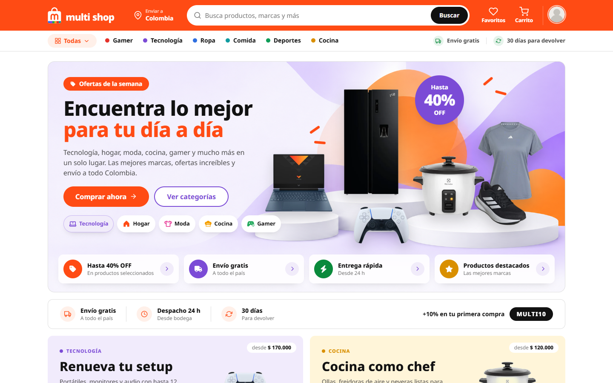
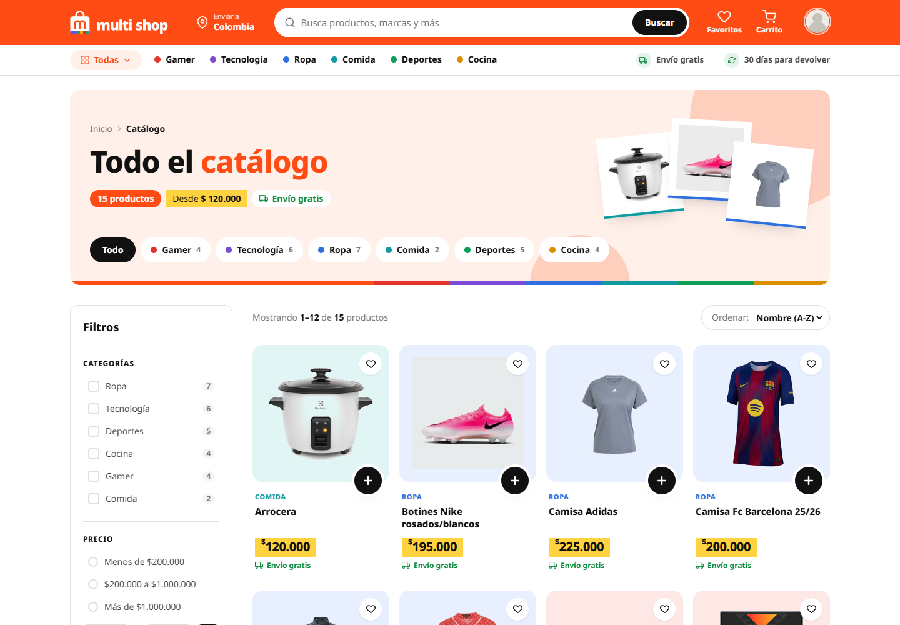
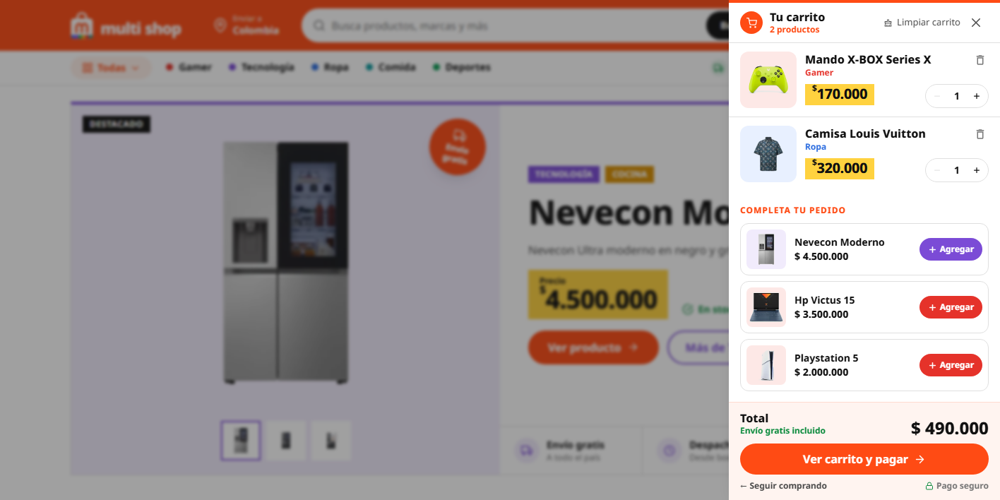
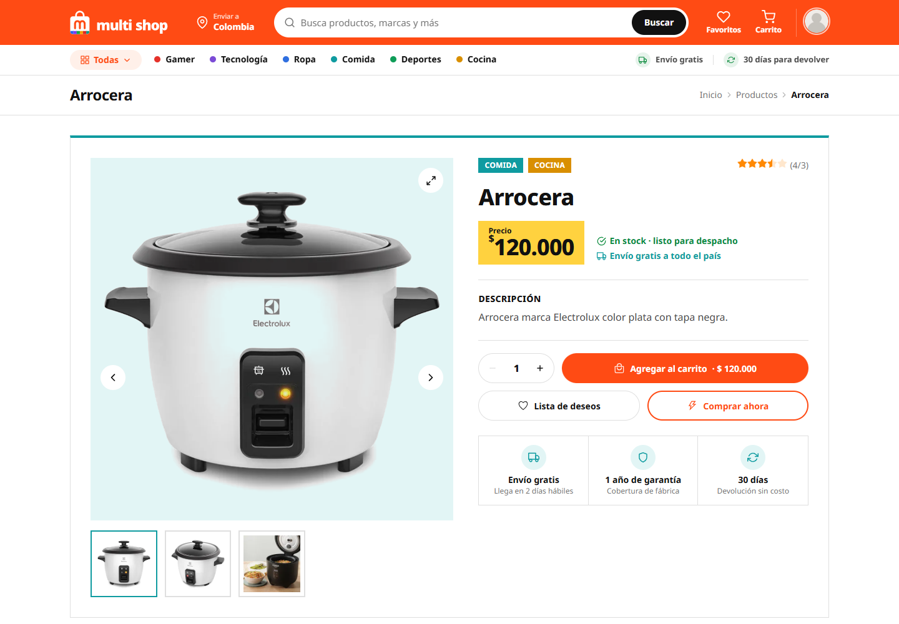
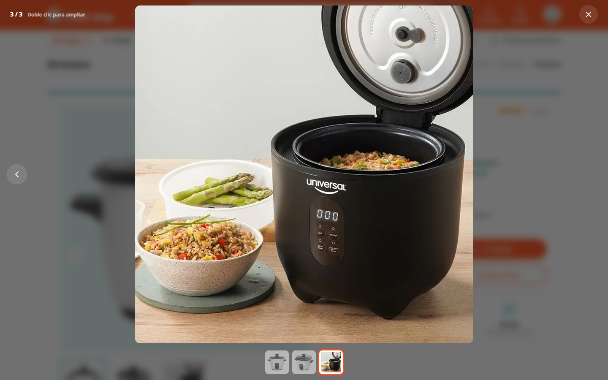
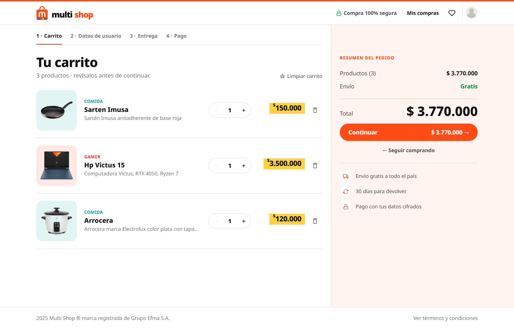
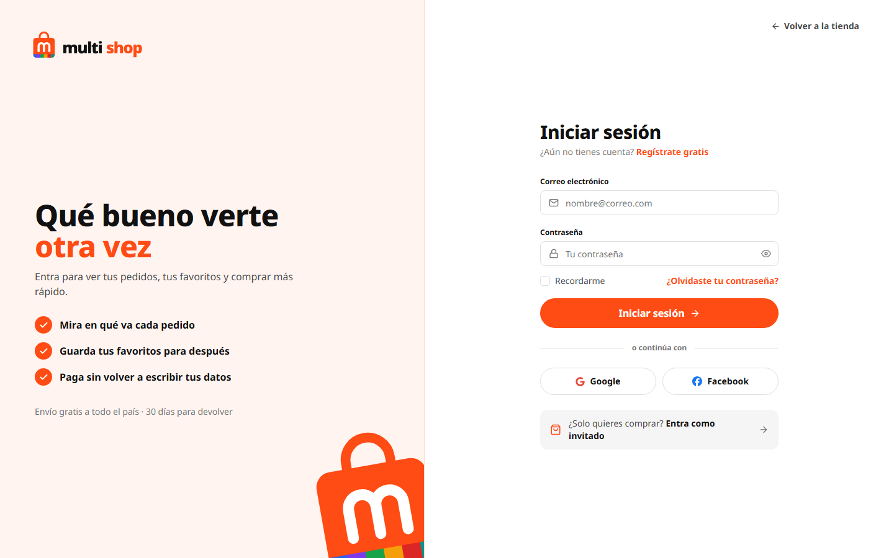

# Multi Shop

## Qué es

Multi Shop es una **tienda en línea de todo un poco**: ropa, tecnología, deportes, cocina, gamer y comida, en un solo lugar y con envío gratis a todo Colombia.

La idea es que comprar se sienta como hojear un **catálogo impreso**: productos ordenados por secciones, fotos grandes, precios que saltan a la vista y ningún paso de más entre "me gusta" y "ya lo pagué".

## Para quién es

Para quien quiere comprar rápido y con confianza, sin perderse entre menús:

| Quiere… | La tienda le da… |
|---|---|
| Encontrar algo rápido | Categorías siempre a la mano en la barra, cada una con su color, un buscador grande y un catálogo con filtros |
| Saber cuánto cuesta sin buscar | Todos los precios en una **etiqueta amarilla** que se ve de lejos |
| Ver bien lo que compra | Fotos grandes y un visor a pantalla completa con zoom |
| Comprar sin miedo | Envío gratis, 30 días para devolver y pago seguro con Stripe, repetidos donde hace falta |
| No crear una cuenta | Puede comprar como invitado |
| Volver después | Una lista de deseos y sus datos guardados para la próxima compra |

## El recorrido de compra

1. **Descubre.** El inicio abre con un banner de ofertas: los productos aparecen sobre plataformas, cada uno lleva a su página y debajo hay accesos rápidos a promociones, envío y destacados. Luego vienen las categorías, los precios bajos y un carrusel por cada categoría, con secciones intermedias que rompen la rutina: un producto estrella, promociones y cómo funciona la compra.
2. **Busca.** El buscador y los enlaces de categoría llevan al **catálogo**: filtros por categoría y precio, cuatro formas de ordenar y 12 productos por página. Los filtros quedan en la dirección, así que una búsqueda se puede compartir o guardar. En el celular los filtros salen en un cajón lateral.
3. **Mira de cerca.** El detalle del producto muestra la galería de fotos, el precio, el stock, el envío y la garantía en una sola vista. Al tocar la foto se abre el **visor**: foto grande, flechas, miniaturas, doble clic para ampliar y teclado (← → y Esc).
4. **Guarda.** Al agregar o quitar algo del carrito o de favoritos aparece un aviso con la foto del producto y un botón **Deshacer**. El carrito se abre de lado sin sacarte de la página, sugiere productos para completar el pedido y actualiza los precios si cambiaron.
5. **Paga en cuatro pasos.** Carrito → tus datos → entrega → pago. El resumen del pedido acompaña cada paso.
6. **Listo.** Una página de confirmación con el número de pedido y lo que sigue. Si el pago se cancela, el carrito queda guardado para intentar de nuevo.

## El diseño

### Identidad

| Elemento | Cómo se usa |
|---|---|
| **Naranja Multi Shop** `#ff4b14` | El color de la marca: la barra superior, los botones principales ("Agregar al carrito", "Continuar", "Pagar") y los detalles que guían la mirada |
| **Morado de ofertas** `#7b4bd6` | El acento del banner del inicio: el sello de descuento y el botón "Ver categorías" |
| **Amarillo de precios** `#ffd23f` | Solo para las etiquetas de precio, como en los catálogos impresos. Si algo es amarillo, es un precio |
| **Negro y blanco** | La base: fondos blancos, textos negros y líneas finas para separar |
| **Verde** | Solo para buenas noticias: envío gratis, en stock, pedido recibido |
| **Logo** | Una **bolsa de compras naranja con una "m"** y, en la base, una franja con **los seis colores de las categorías**: la tienda de todo un poco en un solo símbolo. Tiene versión para fondo blanco, naranja y oscuro, y la bolsa sola como ícono |
| **Tipografía** | Noto Sans, gruesa en títulos y precios para que se lean de un vistazo |

### Un color por categoría

Cada categoría tiene su color. Ese color aparece en el punto de la barra, en el fondo de las fotos, en los botones de las tarjetas, en los títulos de su sección y en la cabecera del catálogo cuando se filtra por ella. Así se sabe dónde está uno sin tener que leer.

| Categoría | Color |
|---|---|
| Ropa | Azul |
| Tecnología | Morado |
| Deportes | Verde |
| Cocina | Ámbar |
| Gamer | Rojo |
| Comida | Turquesa |

Los seis colores juntos forman la **franja multicolor** que se repite en el logo, en la cabecera del catálogo y en el pie de página.

### Principios

| Principio | Qué significa en la tienda |
|---|---|
| **Como un catálogo** | Fotos sobre fondos de color suave, líneas finas y la etiqueta amarilla de precio. Ordenado y fácil de recorrer |
| **El producto primero** | Las fotos son grandes y se pueden ver a pantalla completa; el nombre va en negrita y la descripción larga queda para el detalle |
| **Confianza donde se decide** | El envío gratis, las devoluciones y el pago seguro aparecen justo al lado de los botones de compra, no escondidos en el pie de página |
| **Sin pasos de más** | El carrito se abre sin cambiar de página, se agrega con un solo botón desde cualquier tarjeta, los formularios piden solo lo necesario y los pasos de compra se pueden recorrer hacia atrás |
| **Todo se puede deshacer** | Quitar un producto, limpiar el carrito o vaciar la lista de deseos deja un aviso con "Deshacer" |
| **Todo con sentido** | Nada es decorativo por gusto: cada color dice algo (marca, oferta, precio, categoría o buena noticia) |

### Piezas que se repiten

| Pieza | Dónde aparece |
|---|---|
| **Etiqueta amarilla de precio** | Tarjetas, detalle, carrito, portada y destacados |
| **Tarjeta de producto** | Foto redondeada sobre el color de su categoría, corazón de favoritos arriba y un botón **+** sobre la foto para agregar al carrito. Debajo, la categoría, el nombre, el precio y "Envío gratis" |
| **Tarjeta pequeña** | En los carruseles: el precio va sobre la foto, con una barra del color de la categoría y un botón redondo de carrito |
| **Avisos con foto** | Al agregar o quitar: la foto del producto, qué pasó y un enlace para ver el carrito o los favoritos, o el botón "Deshacer" |
| **Secciones intermedias** | Entre las categorías del inicio: un producto destacado a todo color, un par de promociones y los pasos para comprar |
| **Tarjetas de beneficios** | Envío gratis, 30 días para devolver y pago protegido, al final del inicio y del catálogo |
| **Pantalla partida** | En los pasos de compra: a la izquierda lo que se completa, a la derecha el resumen sobre naranja suave |
| **Campos redondeados** | Todos los formularios usan el mismo campo, con borde naranja al escribir y el error en rojo con su ícono |

### Las pantallas

| Detalle de producto | Visor de fotos |
|---|---|
|  |  |

| Pasos de compra | Ingreso y registro |
|---|---|
|  |  |

### Cómo habla la tienda

- De **tú**, cercana y directa: "Tu carrito", "Completa tu pedido", "Qué bueno verte otra vez".
- Frases cortas que dicen lo que pasa: "No te hicimos ningún cobro", "Envío gratis incluido", "Quitado del carrito".
- En los botones, lo que va a pasar: "Agregar al carrito", "Continuar", "Reintentar el pago", "Deshacer".

---

## Para correr el proyecto

Necesitas Node.js 20.6 o superior y la API de Multi Shop funcionando.

1. Instala las dependencias con `npm install`.
2. Crea un archivo `.env` con `VITE_API_DESARROLLO` y `VITE_API_PRODUCCION` (la dirección de la API) y `SESSION_SECRET` (una clave para la sesión).
3. Arranca con `npm run dev` y abre `http://localhost:5173`.

| Comando | Qué hace |
|---|---|
| `npm run dev` | Arranca la tienda en modo desarrollo |
| `npm run build` | Revisa los tipos y construye la versión para el navegador y el servidor |
| `npm start` | Sirve la versión construida, leyendo el `.env` |
| `npm run lint` | Revisa el código con ESLint |

Está hecho con React, React Router (con renderizado en el servidor), Vite y Tailwind CSS. El carrito y los favoritos usan zustand, los avisos notistack y las galerías y carruseles Swiper.
